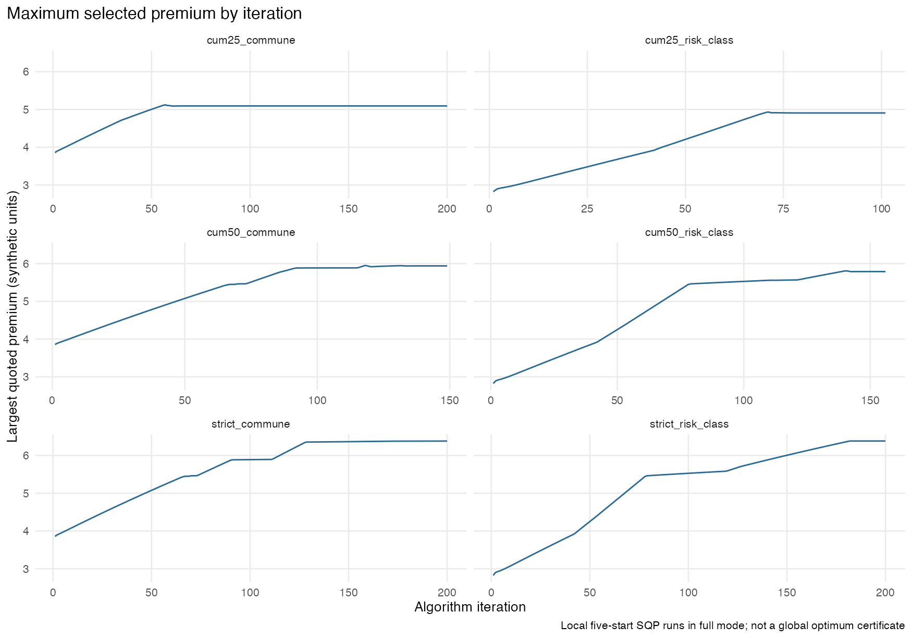
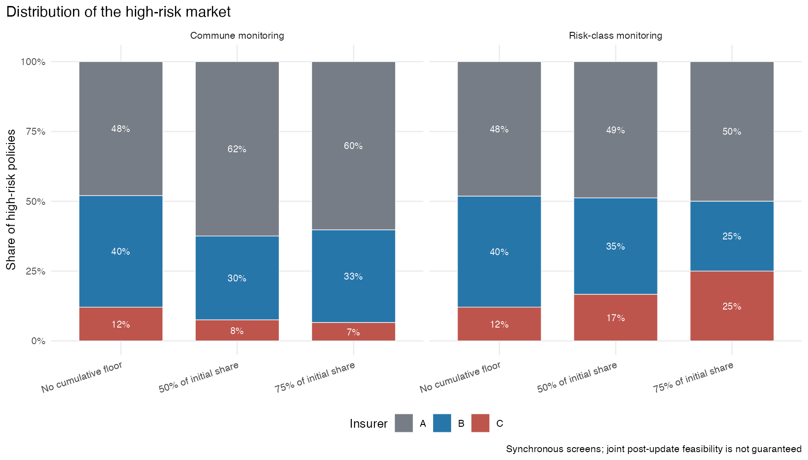
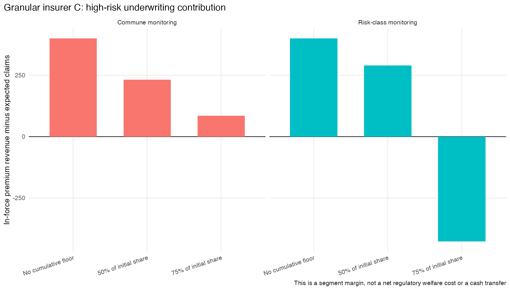
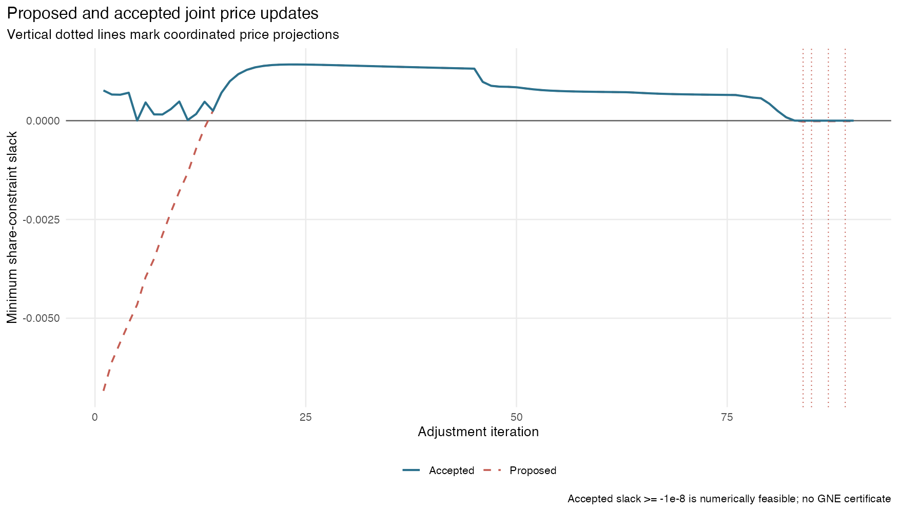
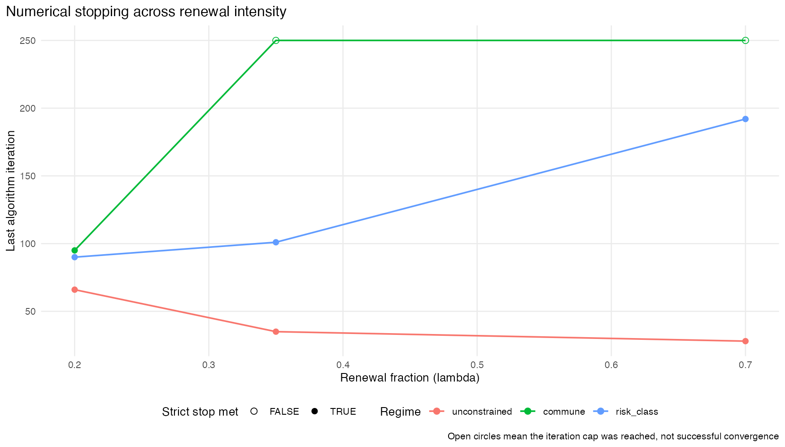
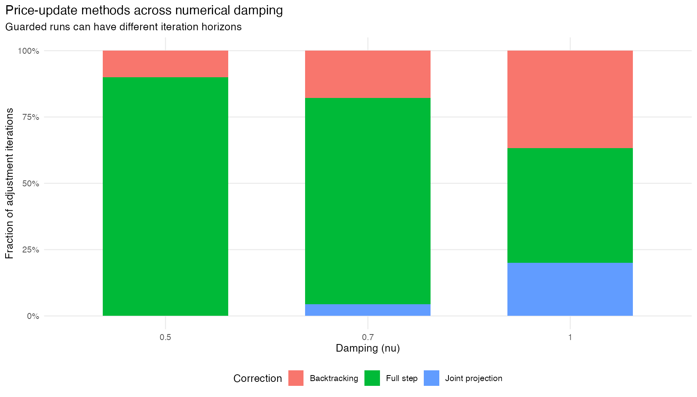
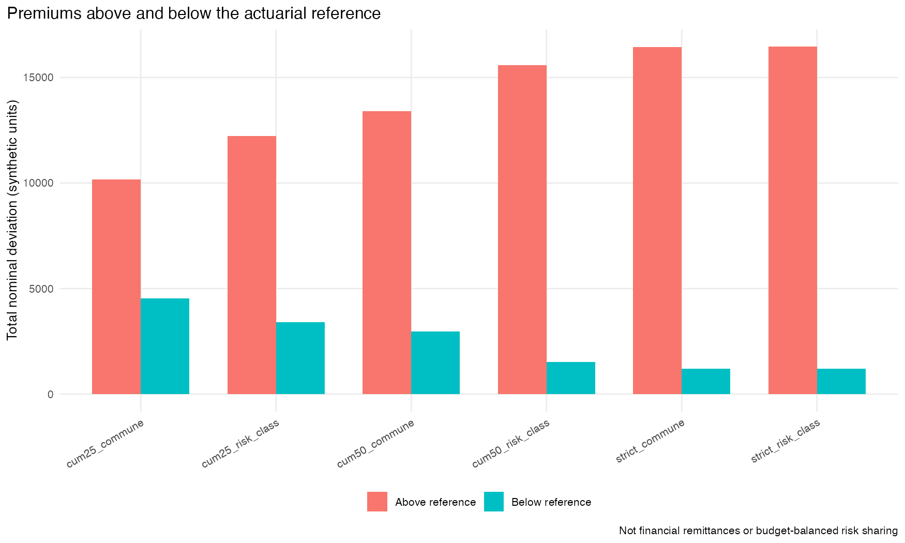

# Replication contract

This document is the **executable experiment**, not a presentation of imported numerical results. Its R source contains the synthetic-market generator, pricing algorithms, constrained local SQP solver, optional jointly feasible price projection, summary calculations, and graphics. **No historical CSV or RDS file is read.** A single Quarto render regenerates the numerical experiments in memory, writes tables to `tables/`, figures to `figures/`, and the GitHub-compatible `reviewer_evidence.md`. CSV files are **outputs**, not inputs. The R packages `nloptr`, `ggplot2`, and `knitr` are required.

**Two distinct protocols.** Synchronous runs implement each insurer's price proposal against lagged rivals and may violate coupled constraints *after* joint implementation. Guarded runs backtrack, or sometimes jointly project, to satisfy all monitored constraints to a numerical tolerance. **Neither protocol certifies a generalized Nash equilibrium**; joint projection is a centralized numerical feasibility device. A period is a numerical iteration, not a year. Monetary quantities are synthetic normalized units, not euros.

**Reproduction warning.** The embedded simulation core is based on the earlier joint-repair source, with the `nloptr::slsqp` inequality interface updated consistently to `deprecatedBehavior=FALSE` (`hin <= 0`, equivalent to economic slacks `>= 0`). This assembled pipeline has not yet been executed in R/Quarto in the authoring environment. Comparisons with previously reported figures and a clean run on the authors' workstation are essential before sharing the Git repository with reviewers. Differences must be disclosed, not concealed or patched by importing old outputs.

**Run modes.** Default `full` runs the complete experiment grid and can be computationally demanding (three insurer architectures, many local SQP optimizations). Use `REVIEWER_MODE=smoke` only for a quick code test; **smoke-mode results are not paper results**. The command for the full run is:

```bash
REVIEWER_MODE=full quarto render reviewer_evidence.qmd --to gfm
```

```bash
REVIEWER_MODE=smoke quarto render reviewer_evidence.qmd --to gfm
```

```{r}
#| label: config
#| include: false
stopifnot(requireNamespace("knitr", quietly=TRUE),
          requireNamespace("ggplot2", quietly=TRUE),
          requireNamespace("nloptr", quietly=TRUE))
MODE <- tolower(Sys.getenv("REVIEWER_MODE", "full"))
stopifnot(MODE %in% c("full", "smoke"))
IS_FULL <- identical(MODE, "full")
SPECS <- list(
  seed=123L, eps_period=.01, eps_cumulative=.25,
  lambda=.35, nu=.7, n_starts=if (IS_FULL) 5L else 2L,
  T_screen=if (IS_FULL) 200L else 10L,
  T_lambda=if (IS_FULL) 250L else 10L,
  T_guard=if (IS_FULL) c(`0.5`=120L,`0.7`=90L,`1.0`=120L) else c(`0.5`=10L,`0.7`=10L,`1.0`=10L),
  T_commune_guard=if (IS_FULL) 45L else 8L,
  T_cap=if (IS_FULL) 200L else 8L,
  tol=1e-8)
dir.create("figures", showWarnings=FALSE, recursive=TRUE)
dir.create("tables", showWarnings=FALSE, recursive=TRUE)
write_table <- function(d, stem) {
  utils::write.csv(d, file.path("tables",paste0(stem,".csv")), row.names=FALSE)
  invisible(d)
}
show_table <- function(d, caption, digits=3L) {
  cat("**", caption, "**\n\n", sep="")
  cat(paste(knitr::kable(d, format="pipe", digits=digits,
                        row.names=FALSE), collapse="\n"), "\n\n", sep="")
}
save_plot <- function(p, stem, width=10, height=5.7) {
  ggplot2::ggsave(file.path("figures",paste0(stem,".png")),p,
                  width=width,height=height,units="in",dpi=175,bg="white")
  ggplot2::ggsave(file.path("figures",paste0(stem,".pdf")),p,
                  width=width,height=height,units="in",device="pdf",bg="white")
}
fmt <- function(x, digits=2L) formatC(x,format="e",digits=digits)
base_theme <- function() ggplot2::theme_minimal(base_size=11) +
  ggplot2::theme(legend.position="bottom",plot.title.position="plot",
                 panel.grid.minor=ggplot2::element_blank())
INS_COLS <- c(A="#777D86",B="#2776AA",C="#BE554C")
REG <- c(strict="No cumulative floor",cum50="50% of initial share",
         cum25="75% of initial share")
MON <- c(commune="Commune monitoring",risk_class="Risk-class monitoring")
```

# The complete R market model

The following executable R chunk is the *full* market model (not a call to an external source file). It constructs municipalities and three risk classes from a seeded Dirichlet distribution; maintains the in-force premium recursively; solves each insurer's locally constrained pricing problem; and records optimization, feasibility, exposure, and quote-versus-book diagnostics. For reviewers, the source of this QMD is the authoritative readable specification; the large model chunk is hidden only in the rendered Markdown to keep the report focused on evidence.

```{r}
#| label: embedded-simulation-engine
#| include: false
# ======================================================================
# Simulation_Construction_joint_repair.R
# ----------------------------------------------------------------------
# Referee-proof numerical core for
# "Granular Pricing and Effective Withdrawal in Climate-Exposed Household Insurance"
#
# Main changes relative to the submitted construction script:
#   1. Portfolio inertia is governed by LAMBDA_REALLOC.
#   2. Retained contracts pay the inherited in-force average premium pbar.
#      New/re-shopping contracts pay the current candidate premium.
#   3. The myopic best-response problem is bounded through demand response,
#      not through an economically unexplained price cap.
#   4. Market-share constraints are evaluated on predicted next-period shares.
#   4b. Optional cumulative presence floors prevent gradual withdrawal.
#   5. Convergence, constraint slacks, price-bound hits, loss-ratio components,
#      and transfer/cross-subsidy diagnostics are recorded.
#
# Embedded in reviewer_evidence.qmd; no external script is required.
# Typical use (after this code chunk):
#   out <- run_market_simulation_revised(scenario = "commune")
#   write_revised_outputs(out, prefix = "commune")
# ======================================================================

if (!requireNamespace("nloptr", quietly = TRUE)) {
  stop("Package 'nloptr' is required. Install it with install.packages('nloptr').")
}
if (!"deprecatedBehavior" %in% names(formals(nloptr::slsqp))) {
  stop("An nloptr::slsqp version supporting deprecatedBehavior=FALSE is required.")
}

# ----------------------------------------------------------------------
# Utility helpers
# ----------------------------------------------------------------------

ensure_dir <- function(path) {
  if (!dir.exists(path)) dir.create(path, recursive = TRUE, showWarnings = FALSE)
  invisible(path)
}

weighted_mean_safe <- function(x, w) {
  ok <- is.finite(x) & is.finite(w) & w > 0
  if (!any(ok)) return(NA_real_)
  sum(x[ok] * w[ok]) / sum(w[ok])
}

# ----------------------------------------------------------------------
# Revised simulation function
# ----------------------------------------------------------------------

run_market_simulation_revised <- function(
  scenario = c("unconstrained", "national", "commune", "risk_class"),
  seed = 123,
  I = 20,
  N_POP = 500,
  DIRICHLET_ALPHA = rep(1, 3),
  RISK_PROB = c(0.1, 0.6, 0.9),
  RISK_COST_PROB = c(0.2, 0.5, 0.8),
  ALPHA = 10.0,
  BETA_PRICE = 1.0,
  V_INSURER = c(A = 0.0, B = 0.0, C = 0.0),
  ETA_CAT = 1.0,
  EPS_SHARE = 0.10,
  CUMULATIVE_PRESENCE = FALSE,
  EPS_CUMULATIVE = 0.25,
  LAMBDA_REALLOC = 0.35,
  DAMPING_NU = 1.0,
  DENOM_EPSILON = 0.0,
  PRICE_LB = 0.01,
  PRICE_UB = Inf,
  CHARGE_FACTOR = 1.02,
  T_MAX = 80,
  TOL_CONVERGENCE = 1e-7,
  FEASIBILITY_GUARD = FALSE,
  GUARD_TOL = 1e-8,
  GUARD_MAX_HALVINGS = 26,
  GUARD_MAX_ZERO_STEPS = 5,
  JOINT_REPAIR = FALSE,
  REPAIR_MAXEVAL = 600,
  REPAIR_NSTARTS = 3,
  N_STARTS = 5,
  quiet = TRUE
) {
  scenario <- match.arg(scenario)
  if (!is.finite(LAMBDA_REALLOC) || LAMBDA_REALLOC <= 0 || LAMBDA_REALLOC > 1) {
    stop("LAMBDA_REALLOC must be in (0,1].")
  }
  if (!is.finite(EPS_SHARE) || EPS_SHARE < 0 || EPS_SHARE > 1) {
    stop("EPS_SHARE must be in [0,1].")
  }
  if (!is.logical(CUMULATIVE_PRESENCE) || length(CUMULATIVE_PRESENCE) != 1) {
    stop("CUMULATIVE_PRESENCE must be TRUE or FALSE.")
  }
  if (!is.finite(EPS_CUMULATIVE) || EPS_CUMULATIVE < 0 || EPS_CUMULATIVE > 1) {
    stop("EPS_CUMULATIVE must be in [0,1].")
  }
  if (!is.finite(DAMPING_NU) || DAMPING_NU <= 0 || DAMPING_NU > 1) {
    stop("DAMPING_NU must be in (0,1].")
  }
  if (!is.logical(FEASIBILITY_GUARD) || length(FEASIBILITY_GUARD) != 1L || is.na(FEASIBILITY_GUARD)) {
    stop("FEASIBILITY_GUARD must be TRUE or FALSE.")
  }
  if (!is.finite(GUARD_TOL) || GUARD_TOL < 0) stop("GUARD_TOL must be nonnegative.")
  if (!is.finite(GUARD_MAX_HALVINGS) || GUARD_MAX_HALVINGS < 1) {
    stop("GUARD_MAX_HALVINGS must be a positive integer.")
  }
  if (!is.logical(JOINT_REPAIR) || length(JOINT_REPAIR) != 1L || is.na(JOINT_REPAIR)) {
    stop("JOINT_REPAIR must be TRUE or FALSE.")
  }
  if (!is.finite(REPAIR_MAXEVAL) || REPAIR_MAXEVAL < 10 ||
      !is.finite(REPAIR_NSTARTS) || REPAIR_NSTARTS < 1) {
    stop("Invalid joint repair controls.")
  }

  constraint_type <- switch(
    scenario,
    unconstrained = "none",
    national = "national",
    commune = "commune",
    risk_class = "risk_class"
  )

  insurers <- c("A", "B", "C")
  archetypes <- c(A = "national", B = "communal", C = "communal_risk")
  R <- length(RISK_PROB)

  get_v_insurer <- function(name) {
    if (!is.null(names(V_INSURER)) && name %in% names(V_INSURER)) return(as.numeric(V_INSURER[[name]]))
    0.0
  }

  rdirichlet <- function(n, alpha) {
    k <- length(alpha)
    x <- matrix(rgamma(n * k, shape = rep(alpha, each = n), rate = 1),
                nrow = n, ncol = k, byrow = FALSE)
    x / rowSums(x)
  }

  set.seed(seed)
  N <- rep(N_POP, I)
  risk_props <- rdirichlet(I, DIRICHLET_ALPHA)
  risk_prob <- RISK_PROB
  risk_cost <- ETA_CAT * ALPHA * RISK_COST_PROB
  u <- as.vector(risk_props %*% risk_prob)
  N_risk <- matrix(N, nrow = I, ncol = R) * risk_props
  pure_ir <- outer(u, risk_cost * risk_prob)
  loaded_fair_ir <- CHARGE_FACTOR * pure_ir
  total_mass <- sum(N_risk)

  primepure <- function() sum(N_risk * pure_ir) / total_mass
  p0 <- primepure() * CHARGE_FACTOR

  get_archetype_shape <- function(archetype_key) {
    if (archetype_key == "national") return(1)
    if (archetype_key == "communal") return(I)
    if (archetype_key == "communal_risk") return(c(I, R))
    stop(sprintf("Unknown archetype: %s", archetype_key))
  }

  reshape_price_to_standard <- function(price, archetype_key) {
    if (archetype_key == "national") return(matrix(as.numeric(price)[1], nrow = I, ncol = R))
    if (archetype_key == "communal") {
      price_vec <- as.numeric(price)
      if (length(price_vec) != I) stop("Invalid communal price vector length.")
      return(matrix(rep(price_vec, each = R), nrow = I, ncol = R, byrow = TRUE))
    }
    if (archetype_key == "communal_risk") {
      if (is.matrix(price) && all(dim(price) == c(I, R))) return(price)
      price_vec <- as.numeric(price)
      if (length(price_vec) != I * R) stop("Invalid communal-risk price vector length.")
      return(matrix(price_vec, nrow = I, ncol = R, byrow = TRUE))
    }
    stop(sprintf("Unknown archetype: %s", archetype_key))
  }

  reshape_price_from_standard <- function(price_matrix, archetype_key) {
    price_matrix <- matrix(as.numeric(price_matrix), nrow = I, ncol = R)
    if (archetype_key == "national") return(mean(price_matrix))
    if (archetype_key == "communal") return(rowMeans(price_matrix))
    if (archetype_key == "communal_risk") return(as.vector(t(price_matrix)))
    stop(sprintf("Unknown archetype: %s", archetype_key))
  }

  archetype_vector_to_object <- function(price_flat, archetype_key) {
    if (archetype_key == "national") return(as.numeric(price_flat)[1])
    if (archetype_key == "communal") return(as.numeric(price_flat))
    if (archetype_key == "communal_risk") {
      return(matrix(as.numeric(price_flat), nrow = I, ncol = R, byrow = TRUE))
    }
    stop(sprintf("Unknown archetype: %s", archetype_key))
  }

  shares_target <- function(prices_dict) {
    sorted_names <- sort(names(prices_dict))
    alpha_u <- matrix(ALPHA * u, nrow = I, ncol = R)
    exp_utils <- lapply(sorted_names, function(name) {
      utilities <- alpha_u + get_v_insurer(name) - BETA_PRICE * prices_dict[[name]]
      exp(pmin(pmax(utilities, -500.0), 400.0))
    })
    denom <- Reduce("+", exp_utils) + DENOM_EPSILON
    out <- list()
    for (k in seq_along(sorted_names)) out[[sorted_names[[k]]]] <- exp_utils[[k]] / denom
    out
  }

  aggregate_share <- function(share_mat, margin = c("national", "commune", "risk_class")) {
    margin <- match.arg(margin)
    if (margin == "national") return(sum(N_risk * share_mat) / sum(N_risk))
    if (margin == "commune") return(rowSums(risk_props * share_mat))
    if (margin == "risk_class") return(colSums(N_risk * share_mat) / colSums(N_risk))
  }

  make_initial_prices <- function() {
    list(
      A = reshape_price_to_standard(p0, "national"),
      B = reshape_price_to_standard(rep(p0, I), "communal"),
      C = reshape_price_to_standard(matrix(p0, nrow = I, ncol = R), "communal_risk")
    )
  }

  prices_prev <- make_initial_prices()
  sigma0 <- shares_target(prices_prev)
  shares_prev <- sigma0
  shares_initial <- sigma0
  pbar_prev <- prices_prev

  price_history <- list(prices_prev)
  share_history <- list(shares_prev)
  pbar_history <- list(pbar_prev)
  diag_records <- list()
  opt_records <- list()
  guard_records <- list()
  consecutive_zero_steps <- 0L
  iter_records <- list(data.frame(period = 0, max_price_change = NA_real_, max_share_change = NA_real_))

  finite_upper <- function(n) {
    if (is.finite(PRICE_UB)) rep(PRICE_UB, n) else rep(1e6, n)
  }

  price_bounds <- function(name) {
    n <- prod(get_archetype_shape(archetypes[[name]]))
    list(lower = rep(PRICE_LB, n), upper = finite_upper(n))
  }

  build_starts <- function(x0, lower, upper, name) {
    starts <- list(x0)
    if (name == "A") cost_start <- reshape_price_from_standard(loaded_fair_ir, "national")
    if (name == "B") cost_start <- reshape_price_from_standard(loaded_fair_ir, "communal")
    if (name == "C") cost_start <- reshape_price_from_standard(loaded_fair_ir, "communal_risk")
    starts[[length(starts) + 1]] <- as.numeric(cost_start)
    if (N_STARTS > length(starts)) {
      for (s in seq_len(N_STARTS - length(starts))) {
        z <- as.numeric(x0) * exp(stats::rnorm(length(x0), sd = 0.10))
        starts[[length(starts) + 1]] <- z
      }
    }
    lapply(starts, function(z) pmin(pmax(as.numeric(z), lower), upper))
  }

  myopic_profit <- function(name, price_flat, rivals_prices, shares_prev, pbar_prev) {
    price_obj <- archetype_vector_to_object(price_flat, archetypes[[name]])
    price_mat <- reshape_price_to_standard(price_obj, archetypes[[name]])
    prices_test <- rivals_prices
    prices_test[[name]] <- price_mat
    sigma <- shares_target(prices_test)[[name]]

    retained_profit <- (1 - LAMBDA_REALLOC) * shares_prev[[name]] * (pbar_prev[[name]] - pure_ir)
    new_profit <- LAMBDA_REALLOC * sigma * (price_mat - pure_ir)
    sum(N_risk * (retained_profit + new_profit))
  }

  constraint_fun_factory <- function(name, rivals_prices, shares_prev, shares_initial) {
    if (constraint_type == "none") return(NULL)
    margin <- constraint_type

    # Period-by-period floor: the insurer cannot lose more than EPS_SHARE
    # of its previous-period aggregate share in the relevant monitoring unit.
    floor_period <- aggregate_share(shares_prev[[name]], margin) * (1 - EPS_SHARE)

    # Cumulative floor: optional genuine presence requirement. It prevents
    # gradual withdrawal by requiring the next-period share to remain above
    # a fixed fraction of the insurer's initial share in the same unit.
    floor_cumulative <- aggregate_share(shares_initial[[name]], margin) * (1 - EPS_CUMULATIVE)

    function(price_flat) {
      price_obj <- archetype_vector_to_object(price_flat, archetypes[[name]])
      price_mat <- reshape_price_to_standard(price_obj, archetypes[[name]])
      prices_test <- rivals_prices
      prices_test[[name]] <- price_mat
      sigma <- shares_target(prices_test)[[name]]
      predicted_next <- (1 - LAMBDA_REALLOC) * shares_prev[[name]] + LAMBDA_REALLOC * sigma
      ag_next <- aggregate_share(predicted_next, margin)

      h <- ag_next - floor_period
      if (CUMULATIVE_PRESENCE) {
        h <- c(h, ag_next - floor_cumulative)
      }
      h
    }
  }

  optimize_one_insurer <- function(name, prices_prev, shares_prev, pbar_prev, t) {
    rivals_prices <- prices_prev[names(prices_prev) != name]
    x0 <- as.numeric(reshape_price_from_standard(prices_prev[[name]], archetypes[[name]]))
    b <- price_bounds(name)
    starts <- build_starts(x0, b$lower, b$upper, name)
    hin <- constraint_fun_factory(name, rivals_prices, shares_prev, shares_initial)

    best <- NULL
    for (s_idx in seq_along(starts)) {
      fn <- function(price_flat) -myopic_profit(name, price_flat, rivals_prices, shares_prev, pbar_prev)
      slsqp_args <- list(
        x0 = starts[[s_idx]],
        fn = fn,
        lower = b$lower,
        upper = b$upper,
        nl.info = FALSE,
        control = list(maxeval = 2000, xtol_rel = 1e-8)
      )
      # The economic slack convention is s(x) >= 0. Modern nloptr::slsqp
      # with deprecatedBehavior=FALSE expects hin(x) <= 0.
      if (!is.null(hin)) slsqp_args$hin <- function(x) -hin(x)
      slsqp_args$deprecatedBehavior <- FALSE
      res <- tryCatch(do.call(nloptr::slsqp, slsqp_args), error = function(e) NULL)
      if (!is.null(res) && !is.null(res$par) && isTRUE(res$convergence >= 0)) {
        val <- -fn(res$par)
        feasible <- TRUE
        if (!is.null(hin)) feasible <- all(hin(res$par) >= -1e-6)
        if (feasible && (is.null(best) || val > best$value)) {
          best <- list(par = res$par, value = val, convergence = res$convergence,
                       selected_start = s_idx)
        }
      }
    }

    if (is.null(best)) {
      warning(sprintf("Optimization failed for insurer %s at t=%s; keeping previous prices.", name, t))
      best <- list(
        par = x0,
        value = myopic_profit(name, x0, rivals_prices, shares_prev, pbar_prev),
        convergence = NA_integer_,
        selected_start = NA_integer_
      )
    }

    opt_records[[length(opt_records) + 1]] <<- data.frame(
      period = t,
      insurer = name,
      n_starts = length(starts),
      selected_start = best$selected_start,
      convergence = best$convergence,
      objective = best$value,
      price_min = min(best$par),
      price_max = max(best$par),
      hit_lower = any(abs(best$par - b$lower) < 1e-6),
      hit_upper = any(is.finite(PRICE_UB) & abs(best$par - b$upper) < 1e-6)
    )

    reshape_price_to_standard(archetype_vector_to_object(best$par, archetypes[[name]]), archetypes[[name]])
  }

  compute_slacks <- function(shares_old, shares_new, shares_initial, period) {
    if (constraint_type == "none") return(NULL)
    do.call(rbind, lapply(insurers, function(name) {
      old_ag <- aggregate_share(shares_old[[name]], constraint_type)
      new_ag <- aggregate_share(shares_new[[name]], constraint_type)
      initial_ag <- aggregate_share(shares_initial[[name]], constraint_type)

      floor_period <- (1 - EPS_SHARE) * old_ag
      out <- data.frame(
        period = period,
        insurer = name,
        constraint_type = constraint_type,
        constraint_label = "period",
        unit = seq_along(new_ag),
        old_share = as.numeric(old_ag),
        initial_share = as.numeric(initial_ag),
        new_share = as.numeric(new_ag),
        floor = as.numeric(floor_period),
        slack = as.numeric(new_ag - floor_period),
        binding = as.numeric(new_ag - floor_period) < 1e-6
      )

      if (CUMULATIVE_PRESENCE) {
        floor_cum <- (1 - EPS_CUMULATIVE) * initial_ag
        out_cum <- data.frame(
          period = period,
          insurer = name,
          constraint_type = constraint_type,
          constraint_label = "cumulative",
          unit = seq_along(new_ag),
          old_share = as.numeric(old_ag),
          initial_share = as.numeric(initial_ag),
          new_share = as.numeric(new_ag),
          floor = as.numeric(floor_cum),
          slack = as.numeric(new_ag - floor_cum),
          binding = as.numeric(new_ag - floor_cum) < 1e-6
        )
        out <- rbind(out, out_cum)
      }
      out
    }))
  }

  # A JOINT, COORDINATED FEASIBILITY RESTORATION (DIAGNOSTIC ONLY).
  # IMPORTANT: all three price vectors are moved jointly. This differs from
  # decentralized best-response dynamics and must be identified as such.
  # It is used ONLY if common-step backtracking fails.
  #
  # Minimize weighted squared distance to proposed (damped) quotes subject to
  # EVERY insurer's next-period period & cumulative market-share floors.
  # Joint infeasibility cannot be inferred from an unsuccessful local solver.
  price_vector <- function(price_list) {
    unlist(lapply(insurers, function(nm) {
      as.numeric(reshape_price_from_standard(price_list[[nm]], archetypes[[nm]]))
    }), use.names = FALSE)
  }

  price_list_from_vector <- function(z) {
    out <- list()
    k <- 0L
    for (nm in insurers) {
      d <- prod(get_archetype_shape(archetypes[[nm]]))
      out[[nm]] <- reshape_price_to_standard(
        archetype_vector_to_object(z[seq.int(k + 1L, k + d)], archetypes[[nm]]),
        archetypes[[nm]]
      )
      k <- k + d
    }
    out
  }

  repair_jointly <- function(raw_prices, previous_prices, shares_old, t) {
    if (constraint_type == "none") return(NULL)

    z_target <- price_vector(raw_prices)
    z_previous <- price_vector(previous_prices)
    z_equal <- price_vector(make_initial_prices())
    pnames <- c("A", "B", "C")
    lb <- unlist(lapply(pnames, function(nm) price_bounds(nm)$lower), use.names = FALSE)
    ub <- unlist(lapply(pnames, function(nm) price_bounds(nm)$upper), use.names = FALSE)
    # Distance measured over actual commune x risk price matrices rather than
    # over their compressed parameter representations; equalizes the roles of
    # insurers with different quotation granularity.
    weights <- c(I * R, rep(R, I), rep(1, I * R))
    weights <- weights / sum(weights)
    eval_next <- function(z) {
      prices <- price_list_from_vector(z)
      sigma <- shares_target(prices)
      shares_new <- lapply(insurers, function(nm) {
        (1 - LAMBDA_REALLOC) * shares_old[[nm]] + LAMBDA_REALLOC * sigma[[nm]]
      })
      names(shares_new) <- insurers
      d <- compute_slacks(shares_old, shares_new, shares_initial, t)
      list(prices = prices, sigma = sigma, shares = shares_new,
           slacks = d$slack, min_slack = min(d$slack))
    }
    # Economic slack >= 0; optimizer API with deprecatedBehavior=FALSE
    # requires inequalities hin <= 0. Post-optimization feasibility is
    # ALWAYS checked on unmodified economic slacks.
    hin <- function(z) -eval_next(z)$slacks
    fn <- function(z) sum(weights * (z - z_target)^2)

    starts <- list(z_target, z_previous, (z_target + z_previous) / 2,
                   z_equal)
    starts <- starts[seq_len(min(length(starts), as.integer(REPAIR_NSTARTS)))]
    best <- NULL
    report <- character(0)
    for (i in seq_along(starts)) {
      args <- list(x0 = pmin(pmax(starts[[i]], lb), ub), fn = fn,
                   lower = lb, upper = ub, hin = hin, nl.info = FALSE,
                   control = list(maxeval = as.integer(REPAIR_MAXEVAL),
                                  xtol_rel = 1e-9))
      args$deprecatedBehavior <- FALSE
      ans <- tryCatch(do.call(nloptr::slsqp, args), error = function(e) e)
      if (inherits(ans, "error") || is.null(ans$par)) {
        report <- c(report, paste0("start ", i, ": error ",
                                  if (inherits(ans, "error")) conditionMessage(ans)
                                  else "empty result"))
        next
      }
      check <- eval_next(ans$par)
      report <- c(report, sprintf("start %d: status=%s, min_slack=%.9g, distance=%.6g",
                                  i, as.character(ans$convergence),
                                  check$min_slack, fn(ans$par)))
      if (is.finite(check$min_slack) && check$min_slack >= -GUARD_TOL &&
          (is.null(best) || fn(ans$par) < best$distance)) {
        best <- list(candidate = check,
                     distance = fn(ans$par),
                     max_abs_adjustment = max(abs(ans$par - z_target)),
                     solver_status = ans$convergence,
                     start = i)
        break # A certified feasible local projection is sufficient for the diagnostic.
      }
    }
    if (!quiet) message("t=", t, " joint repair: ", paste(report, collapse = "; "))
    if (is.null(best)) {
      warning(sprintf("Joint repair NOT certified feasible at t=%d. Details: %s",
                      t, paste(report, collapse = "; ")))
    }
    best
  }

  for (t in seq_len(T_MAX)) {
    prices_br <- prices_prev
    for (name in insurers) {
      prices_br[[name]] <- optimize_one_insurer(name, prices_prev, shares_prev, pbar_prev, t)
    }

    # Feasibility guard: the individual constrained best responses were
    # evaluated holding rivals' OLD quotes fixed. Jointly implementing them
    # may therefore break the constraints. Evaluate all insurers jointly and
    # backtrack the common price step until every constraint is satisfied.
    #
    # This is a feasibility-preserving numerical experiment, NOT a theorem of
    # existence or convergence to a constrained Nash equilibrium.
    candidate_for_scale <- function(scale) {
      trial_prices <- lapply(insurers, function(name) {
        prices_prev[[name]] + DAMPING_NU * scale *
          (prices_br[[name]] - prices_prev[[name]])
      })
      names(trial_prices) <- insurers
      trial_sigma <- shares_target(trial_prices)
      trial_shares <- lapply(insurers, function(name) {
        (1 - LAMBDA_REALLOC) * shares_prev[[name]] +
          LAMBDA_REALLOC * trial_sigma[[name]]
      })
      names(trial_shares) <- insurers
      trial_slacks <- compute_slacks(shares_prev, trial_shares, shares_initial, t)
      worst <- if (is.null(trial_slacks) || nrow(trial_slacks) == 0) {
        Inf
      } else {
        min(trial_slacks$slack, na.rm = TRUE)
      }
      list(prices = trial_prices, sigma = trial_sigma, shares = trial_shares,
           min_slack = worst)
    }

    raw_candidate <- candidate_for_scale(1)
    accepted <- raw_candidate
    step_scale <- 1
    halvings <- 0L
    joint_repair_used <- FALSE
    repair_adjustment <- 0
    repair_solver_status <- NA_integer_
    repair_distance <- NA_real_
    if (FEASIBILITY_GUARD && raw_candidate$min_slack < -GUARD_TOL) {
      accepted <- NULL
      for (k in 1:as.integer(GUARD_MAX_HALVINGS)) {
        trial <- candidate_for_scale(2^(-k))
        if (trial$min_slack >= -GUARD_TOL) {
          accepted <- trial
          step_scale <- 2^(-k)
          halvings <- k
          break
        }
      }
      if (is.null(accepted)) {
        # A local feasibility projection is attempted only after the basic
        # common-step safeguard has failed. It is a COORDINATED intervention.
        if (JOINT_REPAIR) {
          rescue <- repair_jointly(raw_candidate$prices, prices_prev, shares_prev, t)
          if (!is.null(rescue)) {
            accepted <- rescue$candidate
            joint_repair_used <- TRUE
            repair_adjustment <- rescue$max_abs_adjustment
            repair_solver_status <- rescue$solver_status
            repair_distance <- rescue$distance
            step_scale <- NA_real_  # not a scalar backtracking step
          }
        }
        if (is.null(accepted)) {
          trial0 <- candidate_for_scale(0)
          if (trial0$min_slack >= -GUARD_TOL) {
            accepted <- trial0
            step_scale <- 0
            halvings <- as.integer(GUARD_MAX_HALVINGS) + 1L
          } else {
            stop(sprintf(
              paste0("Jointly feasible price update NOT FOUND at t=%d for %s: ",
                     "raw min slack %.7g; zero-step min slack %.7g. ",
                     "Solver failure does NOT prove mathematical infeasibility."),
              t, scenario, raw_candidate$min_slack, trial0$min_slack
            ))
          }
        }
      }
    }
    if (FEASIBILITY_GUARD && accepted$min_slack < -GUARD_TOL) {
      stop("Internal error: accepted step exceeds feasibility tolerance.")
    }
    if (is.finite(step_scale) && step_scale == 0) {
      consecutive_zero_steps <- consecutive_zero_steps + 1L
      if (consecutive_zero_steps >= GUARD_MAX_ZERO_STEPS) {
        stop(sprintf(
          paste0("Feasibility guard STALLED at t=%d (%d zero price ",
                 "steps consecutively): no reliable equilibrium claim. ",
                 "Use a fully constrained joint method."),
          t, consecutive_zero_steps
        ))
      }
    } else {
      consecutive_zero_steps <- 0L
    }
    guard_records[[length(guard_records) + 1L]] <- data.frame(
      period = t, step_scale = step_scale, halvings = halvings,
      min_slack_unchecked = raw_candidate$min_slack,
      min_slack_accepted = accepted$min_slack,
      guarded = is.na(step_scale) || step_scale < 1,
      zero_step = is.finite(step_scale) && step_scale == 0,
      joint_repair = joint_repair_used,
      repair_max_abs_adjustment = repair_adjustment,
      repair_distance = repair_distance,
      repair_solver_status = repair_solver_status
    )
    prices_new <- accepted$prices
    sigma_new <- accepted$sigma
    shares_new <- list()
    pbar_new <- list()
    for (name in insurers) {
      shares_new[[name]] <- (1 - LAMBDA_REALLOC) * shares_prev[[name]] + LAMBDA_REALLOC * sigma_new[[name]]
      numerator <- (1 - LAMBDA_REALLOC) * shares_prev[[name]] * pbar_prev[[name]] +
        LAMBDA_REALLOC * sigma_new[[name]] * prices_new[[name]]
      pbar_new[[name]] <- ifelse(shares_new[[name]] > 1e-14, numerator / shares_new[[name]], prices_new[[name]])
    }

    price_resid <- max(vapply(insurers, function(nm) max(abs(prices_new[[nm]] - prices_prev[[nm]])), numeric(1)))
    share_resid <- max(vapply(insurers, function(nm) max(abs(shares_new[[nm]] - shares_prev[[nm]])), numeric(1)))
    iter_records[[length(iter_records) + 1]] <- data.frame(period = t, max_price_change = price_resid, max_share_change = share_resid)

    slacks <- compute_slacks(shares_prev, shares_new, shares_initial, t)
    if (!is.null(slacks)) diag_records[[length(diag_records) + 1]] <- slacks

    price_history[[length(price_history) + 1]] <- prices_new
    share_history[[length(share_history) + 1]] <- shares_new
    pbar_history[[length(pbar_history) + 1]] <- pbar_new

    prices_prev <- prices_new
    shares_prev <- shares_new
    pbar_prev <- pbar_new

    if (!quiet && (t %% 10 == 0 || t == 1)) {
      message(sprintf("t=%03d price_resid=%.3e share_resid=%.3e", t, price_resid, share_resid))
    }
    if (price_resid < TOL_CONVERGENCE && share_resid < TOL_CONVERGENCE) break
  }

  build_records <- function() {
    rows <- list()
    for (tt in seq_along(price_history) - 1) {
      prices <- price_history[[tt + 1]]
      shares <- share_history[[tt + 1]]
      pbar <- pbar_history[[tt + 1]]

      alpha_u <- matrix(ALPHA * u, nrow = I, ncol = R)
      utilities <- list()
      for (name in insurers) {
        utilities[[name]] <- alpha_u + get_v_insurer(name) - BETA_PRICE * prices[[name]]
      }
      exp_util_sum <- Reduce("+", lapply(utilities, function(mat) exp(pmin(pmax(mat, -500.0), 400.0))))
      logsum_ir <- (1 / BETA_PRICE) * log(exp_util_sum)
      welfare_ea_comm <- rowSums(logsum_ir * risk_props) * N
      welfare_ea_risk <- colSums(logsum_ir * risk_props * matrix(N, nrow = I, ncol = R))
      welfare_ea_global <- sum(welfare_ea_comm)
      welfare_ea_ir <- logsum_ir * risk_props * matrix(N, nrow = I, ncol = R)

      avg_util_ir <- matrix(0, nrow = I, ncol = R)
      for (name in insurers) {
        avg_util_ir <- avg_util_ir + shares[[name]] * (pure_ir - prices[[name]])
      }
      welfare_ep_ir <- matrix(N, nrow = I, ncol = R) * risk_props * avg_util_ir
      welfare_ep_comm <- rowSums(welfare_ep_ir)
      welfare_ep_risk <- colSums(welfare_ep_ir)
      welfare_ep_global <- sum(welfare_ep_ir)

      # Global and commune LR by insurer for compatibility with previous plotting functions.
      lr_global <- list(); lr_comm <- list()
      for (name in insurers) {
        weight_ir <- shares[[name]] * N_risk
        claims_comm <- rowSums(weight_ir * pure_ir)
        premiums_comm <- rowSums(weight_ir * prices[[name]])
        lr_comm[[name]] <- ifelse(premiums_comm > 0, claims_comm / premiums_comm, NA_real_)
        lr_global[[name]] <- ifelse(sum(weight_ir * prices[[name]]) > 0,
                                    sum(weight_ir * pure_ir) / sum(weight_ir * prices[[name]]),
                                    NA_real_)
      }

      for (m in seq_len(I)) {
        for (r in seq_len(R)) {
          row <- list(
            period = tt,
            commune_id = m - 1,
            risk_class = r - 1,
            commune_name = sprintf("commune_%s", m - 1),
            N_commune = N[m],
            risk_proportion = risk_props[m, r],
            risk_prob = u[m],
            risk_cost = risk_cost[r],
            risk_frequency_class = risk_prob[r],
            segment_mass = N_risk[m, r],
            pure_cost = pure_ir[m, r],
            loaded_fair_premium = loaded_fair_ir[m, r],
            scenario_key = scenario,
            welfare_ea_ir = welfare_ea_ir[m, r],
            welfare_ea_comm = welfare_ea_comm[m],
            welfare_ea_risk = welfare_ea_risk[r],
            welfare_ea_global = welfare_ea_global,
            welfare_ep_ir = welfare_ep_ir[m, r],
            welfare_ep_comm = welfare_ep_comm[m],
            welfare_ep_risk = welfare_ep_risk[r],
            welfare_ep_global = welfare_ep_global
          )
          for (name in insurers) {
            sh <- shares[[name]][m, r]
            pr <- prices[[name]][m, r]
            pb <- pbar[[name]][m, r]
            exposure <- N_risk[m, r] * sh
            row[[paste0(name, "_prix")]] <- pr
            row[[paste0(name, "_pbar")]] <- pb
            row[[paste0(name, "_part")]] <- sh
            row[[paste0(name, "_prixpure")]] <- pure_ir[m, r]
            row[[paste0(name, "_marge_infr")]] <- pr - pure_ir[m, r]
            row[[paste0(name, "_exposure")]] <- exposure
            row[[paste0(name, "_claims")]] <- exposure * pure_ir[m, r]
            row[[paste0(name, "_premium_revenue")]] <- exposure * pr
            row[[paste0(name, "_profit_contrib")]] <- exposure * (pr - pure_ir[m, r])
            row[[paste0(name, "_LR_ir")]] <- ifelse(pr > 0, pure_ir[m, r] / pr, NA_real_)
            row[[paste0(name, "_LR_comm")]] <- lr_comm[[name]][m]
            row[[paste0(name, "_LR_global")]] <- lr_global[[name]]
            row[[paste0(name, "_transfer_contrib")]] <- exposure * (pr - loaded_fair_ir[m, r])
            row[[paste0(name, "_subsidy_received_contrib")]] <- exposure * max(loaded_fair_ir[m, r] - pr, 0)
            row[[paste0(name, "_tax_paid_contrib")]] <- exposure * max(pr - loaded_fair_ir[m, r], 0)
          }
          rows[[length(rows) + 1]] <- as.data.frame(row)
        }
      }
    }
    do.call(rbind, rows)
  }

  out <- build_records()
  diagnostics <- if (length(diag_records) > 0) do.call(rbind, diag_records) else data.frame()
  opt_diag <- if (length(opt_records) > 0) do.call(rbind, opt_records) else data.frame()
  convergence <- do.call(rbind, iter_records)
  params <- data.frame(
    parameter = c("scenario", "seed", "I", "N_POP", "DIRICHLET_ALPHA", "RISK_PROB", "RISK_COST_PROB", "ALPHA",
                  "BETA_PRICE", "V_INSURER", "ETA_CAT", "EPS_SHARE", "CUMULATIVE_PRESENCE", "EPS_CUMULATIVE", "LAMBDA_REALLOC", "DAMPING_NU",
                  "DENOM_EPSILON", "PRICE_LB", "PRICE_UB", "CHARGE_FACTOR", "T_MAX", "N_STARTS", "p0",
                  "FEASIBILITY_GUARD", "GUARD_TOL", "GUARD_MAX_HALVINGS",
                  "JOINT_REPAIR", "REPAIR_MAXEVAL", "REPAIR_NSTARTS"),
    value = c(scenario, seed, I, N_POP, paste(DIRICHLET_ALPHA, collapse = ","), paste(RISK_PROB, collapse = ","),
              paste(RISK_COST_PROB, collapse = ","), ALPHA, BETA_PRICE,
              paste(names(V_INSURER), V_INSURER, sep = "=", collapse = ","), ETA_CAT,
              EPS_SHARE, CUMULATIVE_PRESENCE, EPS_CUMULATIVE, LAMBDA_REALLOC, DAMPING_NU, DENOM_EPSILON, PRICE_LB,
              ifelse(is.finite(PRICE_UB), PRICE_UB, "Inf"), CHARGE_FACTOR, T_MAX, N_STARTS, p0,
              FEASIBILITY_GUARD, GUARD_TOL, GUARD_MAX_HALVINGS,
              JOINT_REPAIR, REPAIR_MAXEVAL, REPAIR_NSTARTS),
    stringsAsFactors = FALSE
  )

  structure(
    out,
    constraint_diagnostics = diagnostics,
    optimization_diagnostics = opt_diag,
    convergence_diagnostics = convergence,
    guard_diagnostics = do.call(rbind, guard_records),
    parameters = params,
    class = c("climate_granularity_revised", class(out))
  )
}

# ----------------------------------------------------------------------
# Diagnostic accessors and summaries
# ----------------------------------------------------------------------

constraint_diagnostics <- function(x) attr(x, "constraint_diagnostics")
optimization_diagnostics <- function(x) attr(x, "optimization_diagnostics")
guard_diagnostics <- function(x) attr(x, "guard_diagnostics")
convergence_diagnostics <- function(x) attr(x, "convergence_diagnostics")
parameter_table <- function(x) attr(x, "parameters")

summarise_constraint_diagnostics <- function(x) {
  d <- constraint_diagnostics(x)
  if (is.null(d) || nrow(d) == 0) return(data.frame())
  if (!"constraint_label" %in% names(d)) d$constraint_label <- "period"
  do.call(rbind, lapply(split(d, list(d$constraint_type, d$constraint_label, d$insurer), drop = TRUE), function(z) {
    data.frame(
      constraint_type = z$constraint_type[1],
      constraint_label = z$constraint_label[1],
      insurer = z$insurer[1],
      binding_frequency = mean(z$binding, na.rm = TRUE),
      min_slack = min(z$slack, na.rm = TRUE),
      mean_slack = mean(z$slack, na.rm = TRUE),
      max_slack = max(z$slack, na.rm = TRUE)
    )
  }))
}

summarise_transfers <- function(x, period = max(x$period)) {
  dat <- x[x$period == period, ]
  insurers <- c("A", "B", "C")
  do.call(rbind, lapply(insurers, function(ins) {
    data.frame(
      period = period,
      insurer = ins,
      net_transfer = sum(dat[[paste0(ins, "_transfer_contrib")]], na.rm = TRUE),
      subsidy_received = sum(dat[[paste0(ins, "_subsidy_received_contrib")]], na.rm = TRUE),
      tax_paid = sum(dat[[paste0(ins, "_tax_paid_contrib")]], na.rm = TRUE),
      exposure = sum(dat[[paste0(ins, "_exposure")]], na.rm = TRUE)
    )
  }))
}

loss_ratio_decomposition <- function(x, period = max(x$period)) {
  dat <- x[x$period == period, ]
  insurers <- c("A", "B", "C")
  do.call(rbind, lapply(insurers, function(ins) {
    do.call(rbind, lapply(sort(unique(dat$risk_class)), function(r) {
      z <- dat[dat$risk_class == r, ]
      claims <- sum(z[[paste0(ins, "_claims")]], na.rm = TRUE)
      prem <- sum(z[[paste0(ins, "_premium_revenue")]], na.rm = TRUE)
      exp <- sum(z[[paste0(ins, "_exposure")]], na.rm = TRUE)
      data.frame(
        period = period,
        insurer = ins,
        risk_class = r,
        exposure = exp,
        claims = claims,
        premium_revenue = prem,
        avg_cost = ifelse(exp > 0, claims / exp, NA_real_),
        avg_premium = ifelse(exp > 0, prem / exp, NA_real_),
        loss_ratio = ifelse(prem > 0, claims / prem, NA_real_)
      )
    }))
  }))
}

write_revised_outputs <- function(x,
                                  prefix = attr(x, "parameters")$value[attr(x, "parameters")$parameter == "scenario"],
                                  csv_dir = "Fichiers_csv_revised",
                                  diagnostics_dir = "diagnostics_revised") {
  ensure_dir(csv_dir)
  ensure_dir(diagnostics_dir)
  write.csv(x, file.path(csv_dir, paste0(prefix, ".csv")), row.names = FALSE)
  write.csv(parameter_table(x), file.path(diagnostics_dir, paste0(prefix, "_parameters.csv")), row.names = FALSE)
  write.csv(convergence_diagnostics(x), file.path(diagnostics_dir, paste0(prefix, "_convergence.csv")), row.names = FALSE)
  write.csv(optimization_diagnostics(x), file.path(diagnostics_dir, paste0(prefix, "_optimization.csv")), row.names = FALSE)
  write.csv(constraint_diagnostics(x), file.path(diagnostics_dir, paste0(prefix, "_constraint_slacks.csv")), row.names = FALSE)
  write.csv(summarise_constraint_diagnostics(x), file.path(diagnostics_dir, paste0(prefix, "_constraint_summary.csv")), row.names = FALSE)
  write.csv(loss_ratio_decomposition(x), file.path(diagnostics_dir, paste0(prefix, "_loss_ratio_decomposition_terminal.csv")), row.names = FALSE)
  write.csv(summarise_transfers(x), file.path(diagnostics_dir, paste0(prefix, "_transfers_terminal.csv")), row.names = FALSE)
  invisible(list(csv = file.path(csv_dir, paste0(prefix, ".csv")), diagnostics_dir = diagnostics_dir))
}

```

# 1. Experimental scenarios and optimizer diagnostics

The main six screens cross two monitoring units (commune and risk class) with no cumulative floor, a 50% retained-initial-share floor, and a 75% retained-initial-share floor. All have the same underlying generated municipalities, $\lambda=0.35$, $\nu=0.7$, periodwise relative cap $\varepsilon=0.01$, and seeded five-start local optimization in `full` mode. The `PRICE_UB=Inf` source still translates to a **finite numerical box of $10^6$** inside the SQP solver; we explicitly test finite price caps below. A local solver success code is not a global optimum certificate.

```{r}
#| label: run-all-experiments
#| include: false
# All results are computed from the model above, NOT read from archived files.
run_market <- function(scenario, cumulative=FALSE, epscum=.25,
                       lambda=SPECS$lambda, nu=SPECS$nu,
                       tmax=SPECS$T_screen, guard=FALSE,
                       price_ub=Inf, seed=SPECS$seed) {
  run_market_simulation_revised(
    scenario=scenario, seed=seed,
    EPS_SHARE=SPECS$eps_period,
    CUMULATIVE_PRESENCE=cumulative, EPS_CUMULATIVE=epscum,
    LAMBDA_REALLOC=lambda, DAMPING_NU=nu,
    T_MAX=as.integer(tmax), TOL_CONVERGENCE=1e-7,
    N_STARTS=SPECS$n_starts,
    PRICE_UB=price_ub,
    FEASIBILITY_GUARD=guard, GUARD_TOL=SPECS$tol,
    GUARD_MAX_HALVINGS=26L, GUARD_MAX_ZERO_STEPS=5L,
    JOINT_REPAIR=guard, REPAIR_NSTARTS=4L, REPAIR_MAXEVAL=600L,
    quiet=TRUE)
}
run_log <- list()
warning_log <- list()
safe_run <- function(id, ..., required=TRUE) {
  started <- proc.time()[["elapsed"]]
  warnings <- character()
  out <- tryCatch(
    withCallingHandlers(run_market(...),warning=function(w){
      warnings <<- c(warnings,conditionMessage(w));invokeRestart("muffleWarning")
    }),error=function(e)e)
  elapsed <- proc.time()[["elapsed"]]-started
  warning_log[[id]] <<- if(length(warnings))
    data.frame(Run=id, Warning=warnings) else
    data.frame(Run=character(),Warning=character())
  bad <- inherits(out,"error")
  run_log[[id]] <<- data.frame(Run=id,Status=if(bad)"FAILED" else "COMPLETED",
    Iterations=if(bad) NA_integer_ else max(out$period),
    Warnings=length(warnings),Seconds=round(elapsed,1),
    Error=if(bad) conditionMessage(out) else "")
  if (bad && required) stop("Required simulation ",id," failed: ",conditionMessage(out))
  if (bad) return(NULL)
  out
}
SCENARIOS <- expand.grid(unit=c("commune","risk_class"),
                         floor=c("strict","cum50","cum25"),
                         stringsAsFactors=FALSE)
SCENARIOS$id <- paste(SCENARIOS$floor,SCENARIOS$unit,sep="_")
SCENARIOS$label <- paste(REG[SCENARIOS$floor],MON[SCENARIOS$unit],sep=" / ")
screens <- setNames(lapply(seq_len(nrow(SCENARIOS)),function(i){
  z <- SCENARIOS[i,]
  safe_run(z$id, scenario=z$unit,
           cumulative=z$floor!="strict",
           epscum=if(z$floor=="cum50") .5 else .25)
}),SCENARIOS$id)
# Sensitivity grid: fresh market simulations, each seeded 123.
LAMBDA <- c(.2,.35,.7)
L_GRID <- expand.grid(regime=c("unconstrained","commune","risk_class"),
                      lambda=LAMBDA,stringsAsFactors=FALSE)
L_GRID$id <- sprintf("lambda_%s_%02d",L_GRID$regime,round(100*L_GRID$lambda))
lambda_runs <- setNames(lapply(seq_len(nrow(L_GRID)),function(i){
  z <- L_GRID[i,]
  safe_run(z$id, scenario=z$regime,
    cumulative=z$regime!="unconstrained",
    lambda=z$lambda,tmax=SPECS$T_lambda)
}),L_GRID$id)
# Each guarded simulation is an independent, feasibility-checked experiment.
NU <- c(.5,.7,1)
G_GRID <- data.frame(nu=NU,code=c("0.5","0.7","1.0"),stringsAsFactors=FALSE)
G_GRID$id <- paste0("guard_risk_",G_GRID$code)
guard_runs <- setNames(lapply(seq_len(nrow(G_GRID)),function(i){
  z <- G_GRID[i,]
  safe_run(z$id,scenario="risk_class",cumulative=TRUE,
           nu=z$nu,tmax=SPECS$T_guard[[z$code]],guard=TRUE,required=FALSE)
}),G_GRID$id)
commune_guard <- safe_run("guard_commune",scenario="commune",cumulative=TRUE,
  guard=TRUE,tmax=SPECS$T_commune_guard,required=FALSE)
# Explicit numerical-price-bound stress test (independent reoptimizations).
# The low bound is chosen as a diagnostic, not as a policy constraint.
CAPS <- c(50,200)
cap_runs <- setNames(lapply(CAPS,function(cap){
  safe_run(paste0("cap_unconstrained_",cap),scenario="unconstrained",
    price_ub=cap,tmax=SPECS$T_cap,required=FALSE)
}),paste0("cap_",CAPS))
run_manifest <- do.call(rbind,run_log)
write_table(run_manifest,"00_run_manifest")
run_warnings <- do.call(rbind,warning_log)
write_table(run_warnings,"00_run_warnings")
```

```{r}
#| label: tbl-runs
#| results: asis
show_table(data.frame(Run=run_manifest$Run, Status=run_manifest$Status,
  t=run_manifest$Iterations,Warnings=run_manifest$Warnings,
  Seconds=run_manifest$Seconds),
 "Table S0. Actual model runs performed in this render; failed optional runs are reported, not replaced by archived data.")
```

```{r}
#| label: optimizer-from-new-run
#| results: asis
opts <- do.call(rbind,lapply(names(screens),function(id){
  d <- optimization_diagnostics(screens[[id]])
  d$regime <- id;d
}))
opt_by_run <- do.call(rbind,lapply(split(opts,opts$regime),function(d){
  data.frame(Run=d$regime[1], Updates=nrow(d),
    Starts=min(d$n_starts,na.rm=TRUE),
    Maximum_quote=max(d$price_max,na.rm=TRUE),
    Selected_near_1e6=sum(d$price_max >= 1e6-1e-5,na.rm=TRUE),
    Fallbacks=sum(is.na(d$selected_start)),
    Solver_codes=paste(sort(unique(d$convergence)),collapse=","))
}))
write_table(opt_by_run,"01_optimizer_diagnostics")
show_table(data.frame(Run=opt_by_run$Run,Updates=opt_by_run$Updates,
 Starts=opt_by_run$Starts,Max_quote=round(opt_by_run$Maximum_quote,3),
 Fallbacks=opt_by_run$Fallbacks,Near_upper=opt_by_run$Selected_near_1e6),
 "Table S1. Price bounds and optimizer diagnostics recalculated from fresh simulations.")
opt_path <- stats::aggregate(price_max~period+regime,opts,max)
p1 <- ggplot2::ggplot(opt_path,ggplot2::aes(period,price_max)) +
 ggplot2::geom_line(color="#2D6A93",linewidth=.55) +
 ggplot2::facet_wrap(~regime,scales="free_x",ncol=2) +
 ggplot2::labs(title="Maximum selected premium by iteration",
 x="Algorithm iteration",y="Largest quoted premium (synthetic units)",
 caption="Local five-start SQP runs in full mode; not a global optimum certificate")+base_theme()
save_plot(p1,"S1_optimizer_price_paths",width=10,height=7)
```



```{r}
#| label: tbl-price-ceiling-stress
#| results: asis
cap_row <- function(z,label){
  if(is.null(z)) return(data.frame(Cap=label,Status="FAILED",Max_quote=NA_real_,
    Total_profit_C=NA_real_,High_risk_N_C=NA_real_,Last_t=NA_integer_))
  last <- z[z$period==max(z$period),,drop=FALSE]
  high <- last$risk_class==2
  data.frame(Cap=label,Status="COMPLETED",
   Max_quote=max(vapply(c("A","B","C"),function(nm)
     max(last[[paste0(nm,"_prix")]]),numeric(1))),
   Total_profit_C=sum(last$C_exposure*(last$C_pbar-last$pure_cost)),
   High_risk_N_C=sum(last$C_exposure[high]),Last_t=max(z$period))
}
caps_tab <- do.call(rbind,Map(cap_row,cap_runs,names(cap_runs)))
write_table(caps_tab,"02_reoptimized_finite_price_ceilings")
show_table(data.frame(Cap=caps_tab$Cap,Status=caps_tab$Status,
 Max_quote=round(caps_tab$Max_quote,3),
 C_profit=round(caps_tab$Total_profit_C,1),
 C_high_N=round(caps_tab$High_risk_N_C,1),t=caps_tab$Last_t),
 "Table S2. Independent unconstrained reruns with explicit finite upper price boxes; results are local numerical diagnostics.")
```

# 2. Distribution of high-risk households and cumulative floors

*Reviewer 2, major comments 5–7, 10–11.* The floor is 75% of each insurer's initial share in the monitored unit; a uniform initial share of one third therefore implies a 25% class floor. The following figures show why a commune-level floor need not prohibit **within-commune selection**. The experiment uses synthetic households and does not estimate French market-wide behavior.

```{r}
#| label: derive-synchronous-segments
#| include: false
segment_summary <- function(sim) {
  final <- sim[sim$period==max(sim$period),,drop=FALSE]
  do.call(rbind,lapply(c("A","B","C"),function(firm){
    do.call(rbind,lapply(sort(unique(final$risk_class)),function(risk){
      d <- final[final$risk_class==risk,,drop=FALSE]
      N <- sum(d[[paste0(firm,"_exposure")]])
      quoted <- sum(d[[paste0(firm,"_premium_revenue")]])
      revenue <- sum(d[[paste0(firm,"_exposure")]]*d[[paste0(firm,"_pbar")]])
      claims <- sum(d[[paste0(firm,"_claims")]])
      fair <- sum(d[[paste0(firm,"_exposure")]]*d$loaded_fair_premium)
      data.frame(Insurer=firm,Risk=risk,Exposure=N,Quote_revenue=quoted,
       Book_revenue=revenue,Claims=claims,Loaded_fair_revenue=fair,
       Quote_LR=if(quoted>0)claims/quoted else NA_real_,
       Book_LR=if(revenue>0)claims/revenue else NA_real_,
       Book_profit=revenue-claims,Quote_profit=quoted-claims,Last_t=max(sim$period))
    }))
  }))
}
seg <- do.call(rbind,lapply(seq_along(screens),function(j){
 d <- segment_summary(screens[[j]])
 d$Run <- names(screens)[j]
 d$Unit <- SCENARIOS$unit[j]
 d$Floor <- SCENARIOS$floor[j]
 d
}))
write_table(seg,"03_all_firm_risk_accounting_full")
hi <- subset(seg,Risk==2)
hi$key <- paste(hi$Run,hi$Risk)
hi$Share <- hi$Exposure/ave(hi$Exposure,hi$key,FUN=sum)
stopifnot(max(abs(aggregate(Share~Run,hi,sum)$Share-1)) < 1e-7)
```

```{r}
#| label: tbl-cumulative-results
#| results: asis
hC <- subset(hi,Insurer=="C")
hC <- hC[match(SCENARIOS$id,hC$Run),]
t3 <- data.frame(Regime=hC$Run,t=hC$Last_t,
 N_high=hC$Exposure,Quoted_LR=hC$Quote_LR,Book_LR=hC$Book_LR,
 Book_margin=hC$Book_profit)
write_table(t3,"04_C_highrisk_six_screens")
show_table(data.frame(Regime=t3$Regime,t=t3$t,
 N=round(t3$N_high,1),Quote_LR=round(t3$Quoted_LR,3),
 Book_LR=round(t3$Book_LR,3),Book_margin=round(t3$Book_margin,1)),
 "Table S3. High-risk outcomes of insurer C; premiums quoted versus premiums on the in-force book are distinguished.")
```

```{r}
#| label: fig-high-risk-allocation
#| include: false
hi$Unit <- factor(hi$Unit,levels=c("commune","risk_class"),labels=unname(MON))
hi$Floor <- factor(hi$Floor,levels=c("strict","cum50","cum25"),labels=unname(REG))
hi$Insurer <- factor(hi$Insurer,levels=c("A","B","C"))
p2 <- ggplot2::ggplot(hi,ggplot2::aes(Floor,Share,fill=Insurer))+
 ggplot2::geom_col(width=.72,color="white",linewidth=.25)+
 ggplot2::geom_text(ggplot2::aes(label=paste0(round(Share*100),"%")),
  position=ggplot2::position_stack(vjust=.5),color="white",size=3)+
 ggplot2::facet_wrap(~Unit,ncol=2)+
 ggplot2::scale_fill_manual(values=INS_COLS)+
 ggplot2::scale_y_continuous(labels=function(v) paste0(round(100*v),"%"),limits=c(0,1.01))+
 ggplot2::labs(title="Distribution of the high-risk market",
 x=NULL,y="Share of high-risk policies",fill="Insurer",
 caption="Synchronous screens; joint post-update feasibility is not guaranteed")+
 base_theme()+ggplot2::theme(axis.text.x=ggplot2::element_text(angle=18,hjust=1))
save_plot(p2,"S2_high_risk_allocation")
p3 <- ggplot2::ggplot(subset(hi,Insurer=="C"),
  ggplot2::aes(Floor,Book_profit,fill=Unit))+
 ggplot2::geom_hline(yintercept=0,linewidth=.4)+
 ggplot2::geom_col(width=.64)+ggplot2::facet_wrap(~Unit,ncol=2)+
 ggplot2::labs(title="Granular insurer C: high-risk underwriting contribution",
 x=NULL,y="In-force premium revenue minus expected claims",fill=NULL,
 caption="This is a segment margin, not a net regulatory welfare cost or a cash transfer")+
 base_theme()+ggplot2::theme(axis.text.x=ggplot2::element_text(angle=18,hjust=1),
 legend.position="none")
save_plot(p3,"S3_high_risk_underwriting")
```





```{r}
#| label: tbl-selected-market-shares
#| results: asis
pick <- subset(hi,(Run=="strict_risk_class" | Run=="cum25_commune" |
                  Run=="cum25_risk_class"))
t4 <- data.frame(Run=pick$Run,Insurer=pick$Insurer,N=pick$Exposure,
 Share_pct=100*pick$Share,Book_profit=pick$Book_profit)
write_table(t4,"05_highrisk_shares_three_regimes")
show_table(data.frame(Run=t4$Run,Insurer=t4$Insurer,N=round(t4$N,1),
 Share_pct=round(t4$Share_pct,1),Book_profit=round(t4$Book_profit,0)),
 "Table S4. High-risk policies and insurer shares in the three main comparison regimes.")
```

# 3. Quote versus in-force accounting and presence constraints

*Reviewer 2, major comments 3 and 10–12.* Expected claims are evaluated on insured risk exposures; portfolio accounting uses **in-force average premiums** (`*_pbar`) rather than current quotes (`*_prix`). A segment loss ratio exceeding one means expected claims exceed premium revenue in that segment. It is not equivalent to total insurer insolvency.

```{r}
#| label: tbl-book-classes
#| results: asis
c3 <- subset(seg,Insurer=="C" & Run %in% c("strict_risk_class","cum25_commune","cum25_risk_class"))
c3$Risk <- c("Low","Moderate","High")[c3$Risk+1]
write_table(c3,"06_insurer_C_book_detail_three_regimes")
show_table(data.frame(Regime=c3$Run,Risk=c3$Risk,N=round(c3$Exposure,1),
 Book_price=round(c3$Book_revenue/c3$Exposure,3),
 Cost=round(c3$Claims/c3$Exposure,3),
 Book_LR=round(c3$Book_LR,3),Margin=round(c3$Book_profit,1)),
 "Table S5. Book-based price, pure expected cost, loss ratio and margin for C by risk class.")
```

```{r}
#| label: tbl-synchronous-constraint-slacks
#| results: asis
slack_screen <- do.call(rbind,lapply(c("cum25_commune","cum25_risk_class"),function(id){
 x <- summarise_constraint_diagnostics(screens[[id]])
 if(nrow(x)) x$Run <- id
 x
}))
write_table(slack_screen,"07_synchronous_constraint_diagnostics")
show_table(data.frame(Run=slack_screen$Run,Rule=slack_screen$constraint_label,
 Firm=slack_screen$insurer,
 Binding_pct=round(100*slack_screen$binding_frequency,1),
 Min_slack=fmt(slack_screen$min_slack)),
 "Table S6. Diagnosed shares in the synchronous price-update screens, which may include negative post-update slacks.")
```

# 4. Guarded feasibility and corrective joint projection

*Reviewer 2, major comments 6 and 8.* For the guarded regime, we record the original jointly proposed candidate and the actually accepted joint vector, including backtracking and coordinated repairs. **An accepted feasible update does not establish individual optimality.** A future iteration after a guarded path's recorded horizon is not certified merely because the previous iterations were feasible.

```{r}
#| label: tbl-guard-diagnostics
#| results: asis
guard_parts <- lapply(seq_along(guard_runs),function(i){
 z <- guard_runs[[i]]
 if(is.null(z)) return(NULL)
 d <- guard_diagnostics(z)
 d$Nu <- G_GRID$nu[i];d
})
guard_all <- do.call(rbind,guard_parts)
if(is.null(guard_all)) stop("Every guarded run failed; inspect 00_run_manifest.csv and the corrected solver.")
guard_all$action <- ifelse(guard_all$joint_repair,"Joint projection",
 ifelse(!is.na(guard_all$step_scale) & guard_all$step_scale < 1-1e-12,
 "Backtracking","Full step"))
write_table(guard_all,"08_guarded_steps_all")
gstat <- do.call(rbind,lapply(seq_along(guard_runs),function(i){
 z <- guard_runs[[i]]
 if(is.null(z)) return(data.frame(Nu=G_GRID$nu[i],Status="FAILED",
  t=NA_integer_,Unfeasible_proposed=NA_integer_,Accepted_violations=NA_integer_,
  Backtracks=NA_integer_,Repairs=NA_integer_,Min_accepted=NA_real_))
 d <- guard_diagnostics(z)
 data.frame(Nu=G_GRID$nu[i],Status="COMPLETED",t=nrow(d),
  Unfeasible_proposed=sum(d$min_slack_unchecked < -SPECS$tol),
  Accepted_violations=sum(d$min_slack_accepted < -SPECS$tol),
  Backtracks=sum(!d$joint_repair & !is.na(d$step_scale) & d$step_scale < 1),
  Repairs=sum(d$joint_repair),Min_accepted=min(d$min_slack_accepted))
}))
write_table(gstat,"09_guarded_event_counts")
show_table(data.frame(Nu=gstat$Nu,Status=gstat$Status,t=gstat$t,
  Proposed_infeasible=gstat$Unfeasible_proposed,
  Accepted_infeasible=gstat$Accepted_violations,
  Backtracks=gstat$Backtracks,Joint_repairs=gstat$Repairs,
  Min_slack=fmt(gstat$Min_accepted)),
 "Table S7. Feasibility accounting for independent guarded runs, with their actual horizons.")
if(!is.null(commune_guard)){
 x <- guard_diagnostics(commune_guard)
 cm <- data.frame(Protocol="Guarded commune",t=nrow(x),
  Min_accepted=min(x$min_slack_accepted),
  Projections=sum(x$joint_repair),
  Maximum_price_residual=tail(convergence_diagnostics(commune_guard)$max_price_change,1))
 write_table(cm,"09b_guarded_commune_diagnostic")
 show_table(cm,"Table S7b. Additional guarded commune pilot; feasibility only, not long-run convergence.")
} else cat("The optional guarded-commune run failed; inspect Table S0 before citing it.\n\n")
```

```{r}
#| label: figure-guard-slack
#| include: false
x <- subset(guard_all,Nu==.7)
if(nrow(x)){
 p4 <- ggplot2::ggplot(x,ggplot2::aes(period))+
  ggplot2::geom_hline(yintercept=0,color="grey40")+
  ggplot2::geom_line(ggplot2::aes(y=min_slack_unchecked,color="Proposed"),
                    linewidth=.7,linetype="dashed")+
  ggplot2::geom_line(ggplot2::aes(y=min_slack_accepted,color="Accepted"),linewidth=.8)+
  ggplot2::geom_vline(xintercept=x$period[x$joint_repair],
                      color="#C45D53",linewidth=.4,linetype="dotted")+
  ggplot2::scale_color_manual(values=c(Proposed="#C45D53",Accepted="#2B718D"))+
  ggplot2::labs(title="Proposed and accepted joint price updates",
   subtitle="Vertical dotted lines mark coordinated price projections",
   x="Adjustment iteration",y="Minimum share-constraint slack",color=NULL,
   caption="Accepted slack >= -1e-8 is numerically feasible; no GNE certificate")+
  base_theme()
 save_plot(p4,"S4_proposed_vs_accepted_slack")
}
```

```{r}
#| label: show-guard-figure-if-present
#| results: asis

if (nrow(subset(guard_all, Nu == 0.7)) > 0 &&
    file.exists("figures/S4_proposed_vs_accepted_slack.png")) {

  cat("\n\n")

} else {

  cat("*Figure S4 unavailable: the nu=0.7 guarded run failed. See Table S0.*\n\n")

}
```

# 5. Renewal intensity, damping and convergence

*Reviewer 2, major comments 5, 6, 9.* Renewal fraction $\lambda$ changes the economic reallocation of customers and the mix of premiums collected on the retained book. Damping $\nu$ changes the numerical step toward quoted best responses. These are **not the same parameter**. Experiments ending at the iteration cap are explicitly identified as not converged to the prescribed numerical threshold.

```{r}
#| label: tbl-lambda
#| results: asis
L_stats <- do.call(rbind,lapply(seq_along(lambda_runs),function(i){
 z <- lambda_runs[[i]];spec <- L_GRID[i,]
 last <- z[z$period==max(z$period),,drop=FALSE]
 h <- last$risk_class==2
 cv <- convergence_diagnostics(z)
 pr <- tail(cv$max_price_change,1)
 sr <- tail(cv$max_share_change,1)
 cex <- last$C_exposure[h]
 data.frame(Regime=spec$regime,Lambda=spec$lambda,t=max(z$period),
  Strict_stop=pr<1e-7 && sr<1e-7,
  N_high=sum(cex),LR_high=sum(cex*last$pure_cost[h])/
  sum(cex*last$C_pbar[h]),
  Total_profit_C=sum(last$C_exposure*(last$C_pbar-last$pure_cost)),
  Price_residual=pr,Share_residual=sr)
}))
write_table(L_stats,"10_lambda_sensitivity")
show_table(data.frame(Regime=L_stats$Regime,Lambda=L_stats$Lambda,
 t=L_stats$t,Strict_stop=L_stats$Strict_stop,N_high=round(L_stats$N_high,1),
 LR_high=round(L_stats$LR_high,3),Profit=round(L_stats$Total_profit_C,0)),
 "Table S8. Independent renewal-sensitivity simulations; stopping is a local numerical criterion only.")
```

```{r}
#| label: tbl-nu
#| results: asis
nu_data <- do.call(rbind,lapply(seq_along(guard_runs),function(i){
 z <- guard_runs[[i]]
 if(is.null(z)) return(NULL)
 last <- z[z$period==max(z$period),,drop=FALSE]
 h <- last$risk_class==2
 cv <- convergence_diagnostics(z)
 data.frame(Nu=G_GRID$nu[i],t=max(z$period),
   N_high=sum(last$C_exposure[h]),
   LR_high=sum(last$C_exposure[h]*last$pure_cost[h])/
     sum(last$C_exposure[h]*last$C_pbar[h]),
   Price_residual=tail(cv$max_price_change,1),
   Share_residual=tail(cv$max_share_change,1))
}))
write_table(nu_data,"11_nu_robustness")
show_table(data.frame(Nu=nu_data$Nu,t=nu_data$t,
 N_high=round(nu_data$N_high,3),LR_high=round(nu_data$LR_high,4),
 Price_residual=fmt(nu_data$Price_residual)),
 "Table S9. Guarded damping sensitivity; unequal run horizons are reported.")
```

```{r}
#| label: figure-dynamics
#| include: false
L_stats$Regime <- factor(L_stats$Regime,
 levels=c("unconstrained","commune","risk_class"))
p5 <- ggplot2::ggplot(L_stats,ggplot2::aes(Lambda,t,color=Regime))+
 ggplot2::geom_line(linewidth=.7)+
 ggplot2::geom_point(ggplot2::aes(shape=Strict_stop),size=2.4)+
 ggplot2::scale_shape_manual(values=c(`TRUE`=16,`FALSE`=1))+
 ggplot2::labs(title="Numerical stopping across renewal intensity",
 x="Renewal fraction (lambda)",y="Last algorithm iteration",shape="Strict stop met",
 caption="Open circles mean the iteration cap was reached, not successful convergence")+
 base_theme()
save_plot(p5,"S5_lambda_convergence")
frequency <- aggregate(rep(1,nrow(guard_all)),
  by=list(Nu=guard_all$Nu,Action=guard_all$action),FUN=sum)
names(frequency)[3] <- "Count"
frequency$Total <- ave(frequency$Count,frequency$Nu,FUN=sum)
frequency$Fraction <- frequency$Count/frequency$Total
p6 <- ggplot2::ggplot(frequency,ggplot2::aes(factor(Nu),Fraction,fill=Action))+
 ggplot2::geom_col(width=.62)+
 ggplot2::scale_y_continuous(labels=function(x) paste0(round(100*x),"%"))+
 ggplot2::labs(title="Price-update methods across numerical damping",
 subtitle="Guarded runs can have different iteration horizons",
 x="Damping (nu)",y="Fraction of adjustment iterations",fill="Correction")+
 base_theme()
save_plot(p6,"S6_nu_correction_frequencies")
```





# 6. Actuarial benchmark deviations, not insurer-to-insurer transfers

*Reviewer 2, major comment 12.* A premium above the loaded actuarial benchmark is not a legislated tax paid to another insurer. A premium below that benchmark is not a cash subsidy. The originally named `tax_paid`/`subsidy_received` components are better described as **above-reference**/**below-reference** amounts; their aggregate signed difference need not be zero.

```{r}
#| label: tbl-reference-deviations
#| results: asis
reference <- do.call(rbind,lapply(names(screens),function(id){
 z <- screens[[id]]
 d <- z[z$period==max(z$period),,drop=FALSE]
 above <- below <- 0
 for(nm in c("A","B","C")){
   ex <- d[[paste0(nm,"_exposure")]]
   gap <- d[[paste0(nm,"_prix")]] - d$loaded_fair_premium
   above <- above + sum(ex*pmax(gap,0))
   below <- below + sum(ex*pmax(-gap,0))
 }
 data.frame(Regime=id,Above=above,Below=below,Net=above-below)
}))
stopifnot(max(abs(reference$Above-reference$Below-reference$Net))<1e-6)
write_table(reference,"12_actuarial_reference_deviations")
show_table(data.frame(Regime=reference$Regime,
 Above=round(reference$Above,1),Below=round(reference$Below,1),
 Net=round(reference$Net,1)),
 "Table S10. Premium differences relative to the loaded actuarial benchmark, NOT balanced transfers.")
```

```{r}
#| label: figure-reference-deviations
#| include: false
ref_long <- rbind(data.frame(Regime=reference$Regime,Measure="Above reference",Amount=reference$Above),
 data.frame(Regime=reference$Regime,Measure="Below reference",Amount=reference$Below))
p7 <- ggplot2::ggplot(ref_long,ggplot2::aes(Regime,Amount,fill=Measure))+
 ggplot2::geom_col(position="dodge",width=.72)+
 ggplot2::labs(title="Premiums above and below the actuarial reference",
 x=NULL,y="Total nominal deviation (synthetic units)",fill=NULL,
 caption="Not financial remittances or budget-balanced risk sharing")+
 base_theme()+ggplot2::theme(axis.text.x=ggplot2::element_text(angle=30,hjust=1))
save_plot(p7,"S7_actuarial_reference_deviations",height=6)
```



# 7. Recalculated finite unilateral-deviation diagnostic

*Reviewer 2, major comments 1 and 8.* This is a **new, finite perturbation screen**, calculated at the final guarded risk-class state rather than loaded from the earlier archived deviation CSV. Each insurer is allowed to shift either a single pricing component or all of its pricing components by -10%, -5%, +5%, or +10%. The other insurers' quotes are fixed, while next-period shares respond through the same logit and inertia equations. Constraints are evaluated jointly over all firms and risk classes. Even if no feasible profitable perturbation is found, this is not a proof of GNE or global unilateral optimality.

```{r}
#| label: recompute-deviation-screen
#| include: false
# Quote-varying checks are carried out only if the guarded nu=.7 run succeeded.
single_firm_deviations <- function(z, lambda=.35, tol=c(1e-8,5e-8)) {
  d <- z[z$period==max(z$period),,drop=FALSE]
  d <- d[order(d$commune_id,d$risk_class),]
  I <- length(unique(d$commune_id));R <- length(unique(d$risk_class))
  to_mat <- function(col) matrix(d[[col]],nrow=I,ncol=R,byrow=TRUE)
  mass <- to_mat("segment_mass");cost <- to_mat("pure_cost")
  u <- to_mat("risk_prob");
  firms <- c("A","B","C")
  old_price <- setNames(lapply(firms,function(f) to_mat(paste0(f,"_prix"))),firms)
  old_share <- setNames(lapply(firms,function(f) to_mat(paste0(f,"_part"))),firms)
  book <- setNames(lapply(firms,function(f) to_mat(paste0(f,"_pbar"))),firms)
  get_sigma <- function(p) {
    raw <- lapply(p,function(m) exp(pmin(pmax(10*u-m,-500),400)))
    denom <- Reduce("+",raw)
    lapply(raw,function(e) e/denom)
  }
  evaluate <- function(p) {
    sig <- get_sigma(p)
    next_sh <- setNames(lapply(firms,function(f) (1-lambda)*old_share[[f]]+
                                             lambda*sig[[f]]),firms)
    slacks <- unlist(lapply(firms,function(f){
      old <- colSums(mass*old_share[[f]])/colSums(mass)
      future <- colSums(mass*next_sh[[f]])/colSums(mass)
      c(future-(1-.01)*old, future-.25)
    }))
    pfit <- vapply(firms,function(f)sum(mass*((1-lambda)*old_share[[f]]*
      (book[[f]]-cost) +lambda*sig[[f]]*(p[[f]]-cost))), numeric(1))
    list(profit=pfit, slack=min(slacks))
  }
  base <- evaluate(old_price)
  out <- list()
  for(f in firms) {
    archetype <- if(f=="A")"national" else if(f=="B")"communal" else "granular"
    original <- if(f=="A") old_price[[f]][1,1] else if(f=="B") old_price[[f]][,1] else as.vector(t(old_price[[f]]))
    for(j in seq_along(original)) for(delta in c(-.10,-.05,.05,.10)) {
      x <- original;x[j] <- max(.01,x[j]*(1+delta))
      p <- old_price
      p[[f]] <- if(f=="A")matrix(x,I,R) else if(f=="B")matrix(rep(x,each=R),I,R,byrow=TRUE) else matrix(x,I,R,byrow=TRUE)
      v <- evaluate(p)
      out[[length(out)+1]] <- data.frame(Firm=f,Change="Single component",
         Component=j,Delta=delta,Gain=v$profit[f]-base$profit[f],
         Joint_min_slack=v$slack,Base_min_slack=base$slack)
    }
    for(delta in c(-.10,-.05,.05,.10)) {
      x <- pmax(.01,original*(1+delta))
      p <- old_price
      p[[f]] <- if(f=="A")matrix(x,I,R) else if(f=="B")matrix(rep(x,each=R),I,R,byrow=TRUE) else matrix(x,I,R,byrow=TRUE)
      v <- evaluate(p)
      out[[length(out)+1]] <- data.frame(Firm=f,Change="All components",
        Component=NA_integer_,Delta=delta,Gain=v$profit[f]-base$profit[f],
        Joint_min_slack=v$slack,Base_min_slack=base$slack)
    }
  }
  do.call(rbind,out)
}
if (!is.null(guard_runs[["guard_risk_0.7"]])) {
  candidates <- single_firm_deviations(guard_runs[["guard_risk_0.7"]])
  write_table(candidates,"13_unilateral_candidate_grid_full")
  dev_stats <- do.call(rbind,lapply(split(candidates,candidates$Firm),function(d){
    data.frame(Firm=d$Firm[1],Candidates=nrow(d),
      Feasible_strict=sum(d$Joint_min_slack>=-1e-8),
      Feasible_relaxed=sum(d$Joint_min_slack>=-5e-8),
      Max_feasible_gain=if(any(d$Joint_min_slack>=-5e-8))
        max(d$Gain[d$Joint_min_slack>=-5e-8]) else NA_real_,
      Baseline_next_step_slack=d$Base_min_slack[1])
  }))
  write_table(dev_stats,"14_unilateral_diagnostic_summary")
} else {
  candidates <- NULL;dev_stats <- NULL
}
```

```{r}
#| label: tbl-deviation-grid
#| results: asis
if(!is.null(dev_stats)) {
 show_table(data.frame(Firm=dev_stats$Firm,N=dev_stats$Candidates,
  Strict_feasible=dev_stats$Feasible_strict,
  Relaxed_feasible=dev_stats$Feasible_relaxed,
  Max_gain=round(dev_stats$Max_feasible_gain,4),
  Baseline_next_slack=fmt(dev_stats$Baseline_next_step_slack)),
 "Table S11. New finite one-coordinate and simultaneous-within-insurer deviation scan; relaxed tolerance 5e-8.")
} else cat("The guarded nu=0.7 run was not completed; deviations were NOT evaluated.\n\n")
```

# 8. Environment and replication audit

The CSV exports in `tables/` are derived from the new run. They can be used for independent figure checks, but **are not read by any computation above**. No observed French insurer data or historic Figure 1–4 inputs are claimed to have been regenerated here. The model is seeded identically in each run, but local SQP outputs may vary with solver/library versions. Missing/failed guarded computations remain marked as such; no archived values are inserted in their place.

```{r}
#| label: tbl-manifest
#| results: asis

# Save replication objects
saveRDS(
  list(
    screens = screens,
    lambda = lambda_runs,
    guarded = guard_runs,
    commune_guard = commune_guard,
    price_caps = cap_runs
  ),
  file.path("tables", "replicated_simulations.rds")
)

writeLines(
  capture.output(sessionInfo()),
  file.path("tables", "sessionInfo.txt")
)

# Inventory of output files
files <- c(
  list.files("tables",
             pattern = "[.](csv|rds|txt)$",
             full.names = TRUE),
  list.files("figures",
             pattern = "[.](png|pdf)$",
             full.names = TRUE)
)

# Exclude the manifest from its own checksum
files <- setdiff(
  files,
  file.path("tables", "15_output_file_manifest.csv")
)

files <- sort(unique(files[file.exists(files)]))

inventory <- data.frame(
  File = files,
  Bytes = as.numeric(file.info(files)$size),
  MD5 = unname(tools::md5sum(files))
)

write_table(inventory, "15_output_file_manifest")

counts <- data.frame(
  Items = c(
    "Simulation runs",
    "CSV tables",
    "PNG figures",
    "PDF figures"
  ),
  Count = c(
    nrow(run_manifest),
    length(list.files("tables", pattern = "[.]csv$")),
    length(list.files("figures", pattern = "[.]png$")),
    length(list.files("figures", pattern = "[.]pdf$"))
  )
)

show_table(
  counts,
  "Table S12. Files produced by this render."
)
```

**Remaining research checks.** These experiments allow audit of the model specification, synthetic scenarios, and implemented feasibility guard. They do not certify global maximizers, GNE existence/convergence, causal effects on real insurance portfolios, or original questionnaire/quote data provenance. For final submission, compare fresh outputs to the reported tables, rerun the complete corrected engine in a controlled R environment, and retain the exact package versions and console log.
